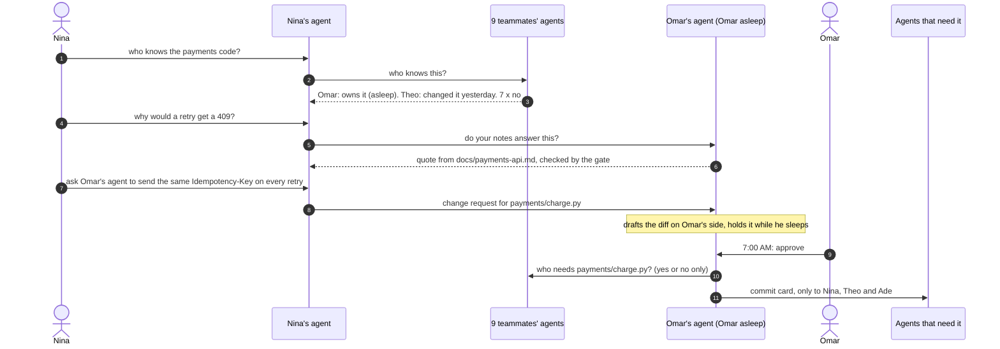

# WhoKnows

[](https://github.com/Aadharsh21/WhoKnows/actions/workflows/tests.yml)

**Your teammate's asleep. Their agent isn't.**

Everyone on a team gets their own AI agent. When you need something, your agent finds whoever knows about it, answers from what that person already wrote down, and waits for their yes before touching their files or their time. When a shared file changes, the people it affects get a commit-style card. Nobody else hears about it, and nobody gets woken up.

Built for the Cubbie Hackathon at DevHacks 2026, Track 2 (agent-to-agent coordination).

**[Play the demo](https://aadharsh21.github.io/WhoKnows/)** · **[See the numbers](#in-numbers)** · **[Run it in Discord](#run-it-in-discord)** · **[Read the one-page design](docs/design.md)**

## The problem

On a team of ten, nobody knows who knows what. The answer to "who did the payments code?" is buried in a group chat, the file you need is on someone's laptop, and the one person who can help went to bed two hours ago. So you ping everyone, wake someone up, or wait.

Psychologists call a team's sense of who knows what its *transactive memory* (Wegner, 1985): groups work best when each member knows where knowledge lives instead of holding all of it. WhoKnows gives every teammate an agent that is that memory for them, and that can act on it without breaking anyone's boundaries.

## The story

1:07 AM. A 10-person capstone team demos at 9:00 AM. Checkout fails after the card step, and Nina doesn't know who wrote the payments code.

1. **Who knows.** Nina's agent asks all nine agents at once. Each checks only its own person's work: the team plan, the repo's CODEOWNERS file, recent commits, and what the person said they're doing. Two answer: Omar owns payments (asleep), and Theo changed the retry code yesterday at 4:12 PM. The other seven just say no.
2. **Answers with sources.** Nina asks why a retry would get a 409. Omar's agent answers for him while he sleeps, quoting his shareable notes word for word and naming the file. Theo's agent quotes his note on the retry change. Together they point at the bug. Omar's draft fix waits for his yes, and his secrets never come up.
3. **Asking first.** Theo is awake, but his agent asks him before offering his time.
4. **No part rests on one person.** Every half hour the agents compare who's doing what. They split the README between two people who both started it, find a volunteer for the demo video nobody owns, and notice that only Nina knows checkout and only Priya knows login. Ade and Lucas become backups, and their agents pull the shareable notes right away.
5. **Changes as requests.** Nina and Theo each ask Omar's agent to change the same lines of his file, in different ways. Nothing changes. Both wait for Omar.
6. **7:00 AM.** Omar wakes up to a receipt of everything his agent did for him overnight, then a few short questions: which fix (he sees both diffs), whether to share his draft, and one shared slot for the three people who need him before 9. He picks Nina's fix, and his agent offers to let her small changes through next time.
7. **Commits go only where they matter.** The change goes to Nina (she asked), Theo (he changed that code yesterday) and Ade (he tests checkout). The other six never see it. When Omar edits his notes, Nina's agent gets the change too, because those notes were quoted to her.
8. **Trust that grows.** At 7:50 Nina asks for a one-line docstring. Omar said her small changes can go through, so it saves right away. He still gets the commit, with undo one tap away.

At five points in the demo you decide for a teammate, and the rest of the night follows from what you picked. All 48 combinations are generated by the engine in this repo.

There's also a **rogue agent** story: Theo's agent reads a poisoned README and tries to steal Omar's secrets, wipe his file without approval, and get other agents to leak files. Every attempt stops at a gate, and Omar hears about it when he wakes up.

## In numbers

One night is a story, so we also measured it. `python3 -m whoknows.bench` generates teams of 30, each with a plan, a CODEOWNERS file, a git history, and everyone's notes, drafts and secrets. It asks a week of questions, about one per person per day, at times the asker is awake. The real agents answer every one. Two baselines get the same questions: a team group chat, and messaging your best guess from the team plan. Where a rule for the baselines had to be guessed, it was guessed in their favor.

Five teams of 30, a week each, 1,050 questions:

| | Group chat | Message your best guess | WhoKnows |
|---|---|---|---|
| People notified per question | 29.0 | 5.3 | **1.2** |
| Notifications that reached someone asleep, per week | 678 | 117 | **12** |
| Average wait for the answer | 41 min | 51 min | **21 min** |
| Wait for the slowest 1 in 10 | 49 min | 1h 27m | **15 min** |
| Answered on the spot | 0% | 0% | **49%** |
| First person asked knew the answer | 100% | 65% | **96%** |

All 12 of WhoKnows' night notifications came from the 25 times its agents couldn't find the person who knew and the asker fell back to the group chat. The agents themselves never pinged anyone asleep, at any setting. Nothing private was sent, and the gates blocked nothing.

How much people write down matters. With nothing in shared notes, WhoKnows notifies 2.7 people per question; at 75% written, 0.5. As teams grow from 5 to 50 people, a group chat notifies 4 to 49 people per question, and WhoKnows stays between 0.6 and 1.9.

What it assumes, in short: an awake person answers within 15 minutes and a sleeping one 15 minutes after waking; about a quarter of answers belong to whoever changed a part recently rather than its owner; a few belong to someone who left no trace anywhere; half of all answers are in notes their holder shares. Questions use the same words as the plan and the notes, and real questions are messier, so keyword routing would miss some of them. The full list is in [`whoknows/bench.py`](whoknows/bench.py) and on the site.

## How it works



### What the agents share

Every file is in one of three tiers, set by its owner:

| Tier | Example | What the agent does |
|---|---|---|
| Shared on its own | `notes/*`, `docs/*` | Quotes it or sends it when it's relevant |
| Shared after a yes | drafts, code, anything not listed | Says it exists and asks its person |
| Never leaves | `.env`, keys, `personal/*` | Won't send it, quote it, mention it, or confirm it exists |

Secrets and personal folders are always in the last tier, whatever a person's own rules say. A **gate** sits under every agent: it re-reads every outgoing file from disk, re-applies the owner's rules, checks that every quote really appears in the file it names, refuses to pass along anyone else's files, and scans all text for things that look like keys. A tricked agent still can't get a private file past it.

Other agents learn only short answers: "owns it", "changed it recently", "no", "yes", and quotes from files their owner shares. When a change goes out, the owner's agent asks every agent "who needs this file?" and each answers yes or no from what only it knows (a copy it holds, a quote it was given, a change it asked for, code its person touched, files its person watches).

### When agents ask their person

- Before giving away their time.
- Before sharing anything not marked shareable.
- Before any change to their files. A change request is drafted on the owner's side and shown as an exact before and after, with red flags added in code (large deletions, anything that looks like a key, requests to skip approval).
- Until they say otherwise: after approving a small, clean change, the owner can let that teammate's changes of five lines or fewer, with no red flags, in that folder, go through without asking. Each one still sends a commit and asks "keep it?", and undo is one tap.
- **Never while they sleep.** Questions wait for morning and news goes into one summary. Anything an agent did without asking goes on a receipt, with one tap to make it ask first next time. In all 48 branches, no phone lights up for someone asleep, and a test checks it.

## Track 2 fit

| Requirement | How WhoKnows meets it |
|---|---|
| Personal agents for different students | Every teammate has one. It knows only its own person's work and answers only for them. |
| Exchange what matters toward a shared outcome | Finding who knows, answering from notes, sharing files, asking for time, lining up backups, and proposing changes, all toward a working demo by 9 AM. |
| Conflicting constraints | Two fixes for the same lines, three people needing one person before a deadline, two owners for the README, a part nobody owns, parts only one person knows, and changes written against an old version. |
| What they share | One-word answers, one-line reasons, quotes checked against the file, files by each owner's tiers, and commit cards only to the people a change affects. Never secrets or personal files, enforced by a gate in code. |
| When they ask their students | Before time, before ask-tier files, and before any change, until the owner grants a small, revocable rule. Never while they sleep. |
| Does it help | On a week of questions: 1.2 people notified per question instead of 29 in a group chat, and no agent ever pinged anyone asleep. |

## Run it in a terminal

Python 3.9 or newer, standard library only.

```sh
python3 -m whoknows                                   # the 1 AM story with the default choices
python3 -m whoknows --choose omar_fix=theo --choose theo_help=no
python3 -m whoknows --rogue                           # the rogue agent story
python3 -m whoknows --quiet                           # only what people see, no agent traffic
python3 -m whoknows --export site/traces              # regenerate every branch for the site
python3 -m whoknows.bench --out site/bench.json       # the benchmark (about a minute)
```

Choices: `theo_help` (yes, no), `ade_take_demo-video` (yes, no), `omar_fix` (nina, theo, neither), `omar_share` (share, keep), `omar_slot` (yes, no).

## Play the site

The site replays traces from the engine and reads the benchmark's results file, so every value on screen comes from running the code.

```sh
python3 -m http.server -d site 8000      # then open http://localhost:8000
```

## Run it in Discord

The same agents, live. Each person DMs the bot, takes a seat (`seat nina`), and from then on talks to their own agent. Seats nobody takes are played by simulated teammates who follow the same rules.

1. Create an application at the Discord Developer Portal, add a bot, and copy its token.
2. Invite it to your server with the `bot` scope and the Send Messages, Read Message History and Manage Channels permissions.
3. Run it:

```sh
pip install -r requirements-bot.txt
export DISCORD_BOT_TOKEN=...
export ANTHROPIC_API_KEY=...        # optional: free-form messages and drafting new kinds of changes
python3 -m whoknows.bot
```

The bot creates three channels: `#backchannel` (every message between agents, and everything a gate blocked), `#team-board`, and `#teammates` (what the simulated teammates see). In a DM, try:

```
seat nina
who knows the payments code?
why would a retry get a 409?
pass it on
get omar's notes on payments
ask omar's agent to send the same idempotency key on every retry in charge.py
skip to 7:00
```

Have a friend take Omar's seat and they'll get the approve and decline buttons at 7:00. Without an API key the bot understands the phrasings above and similar ones. With a key, Claude Haiku reads anything else into the same small set of actions, and Claude Sonnet drafts changes the demo has no recipe for. A model's output is only ever a proposal that the owner approves.

## Tests

```sh
python3 -m unittest discover -s tests
```

73 tests cover the sharing tiers, the gate (including made-up and private quotes), search, file paths, diffs and collisions, who-knows routing from git history, answers with sources, passing questions on, backups for parts only one person knows, receipts, trust rules and undo, change requests (picking between rivals, rewriting stale requests, red flags), commit routing, time slots, the team board, every one of the 48 story branches (nothing private crosses, nobody is woken, runs are identical), the rogue agent, the benchmark, and the live Discord layer. GitHub Actions runs them on Python 3.9 and 3.13 on every push, and checks that the site's traces match the code.

## Project layout

| Path | What it is |
|---|---|
| `whoknows/agent.py` | One person's agent: answering, sharing, asking, change requests, commits, trust |
| `whoknows/gate.py` | The gate every outgoing message passes through |
| `whoknows/policy.py` | Sharing tiers |
| `whoknows/search.py` | Finding the passage in a person's own files that answers a question |
| `whoknows/cards.py` | Who works on what, from the team plan, CODEOWNERS, git and what people said |
| `whoknows/network.py` | Message delivery, sleep and wake, the team board and backups, the trace |
| `whoknows/scenario.py` | The demo team: ten people, their folders, and a real git history |
| `whoknows/story.py` | The 1 AM story and the rogue story |
| `whoknows/bench.py` | The benchmark against a group chat and messaging your best guess |
| `whoknows/live.py`, `whoknows/bot.py` | Live seats and the Discord bot |
| `whoknows/understand.py`, `whoknows/drafting.py` | Reading what people type, and drafting changes |
| `site/` | The playable site |
| `docs/design.md` | The design on one page: goals, protocol, threat model, trade-offs |
| `docs/video.md` | Shot list and script for the 90 second demo video |

## Limits

This is a hackathon prototype. All agents run in one process, and the files are folders on one machine. In real use each agent would run on its own person's device and talk over the network, which is why the protocol only ever passes short answers, checked quotes, and explicitly allowed files. Routing and search match words, so a question phrased very differently from the plan and the notes can miss. Everyone in the demo is made up, and so are their files and keys.

## Team

Aadharsh Arunn and Swayam.
