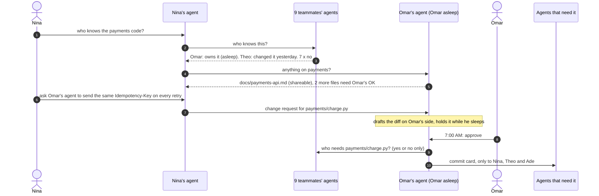

# WhoKnows

**Your teammate's asleep. Their agent isn't.**

Everyone on a team gets their own AI agent. When you need something, your agent finds whoever knows about it, gets what that person's rules allow, and waits for their yes before touching their files or their time. When a shared file changes, the people it affects get a commit-style card. Nobody else hears about it, and nobody gets woken up.

Built for the Cubbie Hackathon at DevHacks 2026, Track 2 (agent-to-agent coordination).

**[Play the demo](https://aadharsh21.github.io/WhoKnows/)** · **[Run it in Discord](#run-it-in-discord)** · **[Run it in a terminal](#run-it-in-a-terminal)**

## The problem

On a team of ten, nobody knows who knows what. The answer to "who did the payments code?" is buried in a group chat, the file you need is on someone's laptop, and the one person who can help went to bed two hours ago. So you ping everyone, wake someone up, or wait.

Psychologists call a team's sense of who knows what its *transactive memory* (Wegner, 1985): groups work best when each member knows where knowledge lives instead of holding all of it. WhoKnows gives every teammate an agent that is that memory for them, and that can act on it without breaking anyone's boundaries.

## The story

1:07 AM. A 10-person capstone team demos at 9:00 AM. Checkout fails after the card step, and Nina doesn't know who wrote the payments code.

1. **Who knows.** Nina's agent asks all nine agents at once. Each checks only its own person's work: the team plan, the repo's CODEOWNERS file, recent commits, and what the person said they're doing. Two answer: Omar owns payments (asleep), and Theo changed the retry code yesterday at 4:12 PM. The other seven just say no.
2. **What crosses.** Omar is asleep, so his agent follows his rules: his API notes go out, his half-finished fix waits for his yes, and his secrets never leave.
3. **Asking first.** Theo is awake, but his agent asks him before offering his time.
4. **Team-sized conflicts.** The agents notice Lucas and Ade are both writing the README and suggest a split, and that nobody owns the demo video, so they ask whoever is awake and good at it.
5. **Changes as requests.** Nina and Theo each ask Omar's agent to change the same lines of his file, in different ways. Nothing changes. Both wait for Omar.
6. **7:00 AM.** Omar wakes up to three short questions: which fix (he sees both diffs), whether to share his draft, and one shared slot for the three people who need him before 9. He picks Nina's fix.
7. **Commits go only where they matter.** The change goes to Nina (she asked), Theo (he changed that code yesterday) and Ade (he tests checkout). The other six never see it. Nina gets it in her morning summary instead of a 7 AM ping. When Omar later edits his notes, Nina's copy refreshes itself.

At five points in the demo you decide for a teammate, and the rest of the night follows from what you picked. All 48 combinations are generated by the engine in this repo.

There's also a **rogue agent** story: Theo's agent reads a poisoned README and tries to steal Omar's secrets, wipe his file without approval, and get other agents to leak files. Every attempt stops at a gate, and Omar hears about it when he wakes up.

## How it works



### What the agents share

Every file is in one of three tiers, set by its owner:

| Tier | Example | What the agent does |
|---|---|---|
| Shared on its own | `notes/*`, `docs/*` | Sends it when it's relevant |
| Shared after a yes | drafts, code, anything not listed | Says it exists and asks its person |
| Never leaves | `.env`, keys, `personal/*` | Won't send it, mention it, or confirm it exists |

Secrets and personal folders are always in the last tier, whatever a person's own rules say. A **gate** sits under every agent: it re-reads every outgoing file from disk, re-applies the owner's rules, refuses to pass along anyone else's files, and scans all text for things that look like keys. A tricked agent still can't get a private file past it.

Other agents learn only short answers: "owns it", "changed it recently", "no", "yes". When a change goes out, the owner's agent asks every agent "who needs this file?" and each answers yes or no from what only it knows (a copy it holds, a change it asked for, code its person touched, files its person watches).

### When agents ask their person

- Before giving away their time.
- Before sharing anything not marked shareable.
- Before any change to their files. A change request is drafted on the owner's side and shown as an exact before and after, with red flags added in code (large deletions, anything that looks like a key, requests to skip approval). Undo is one step and also sends a commit.
- **Never while they sleep.** Questions wait for morning and news goes into one summary. In all 48 branches, no phone lights up for someone asleep, and a test checks it.

## Track 2 fit

| Requirement | How WhoKnows meets it |
|---|---|
| Personal agents for different students | Every teammate has one. It knows only its own person's work and answers only for them. |
| Exchange what matters toward a shared outcome | Finding who knows, sharing notes, asking for time and proposing changes, all toward a working demo by 9 AM. |
| Conflicting constraints | Two fixes for the same lines, three people needing one person before a deadline, two owners for the README, a part nobody owns, and changes written against an old version. |
| What they share | One-word answers and one-line reasons, files by each owner's tiers, and commit cards only to the people a change affects. Never secrets or personal files, enforced by a gate in code. |
| When they ask their students | Before time, before ask-tier files, before any change. Never while they sleep. |

## Run it in a terminal

Python 3.9 or newer, standard library only.

```sh
python3 -m whoknows                                   # the 1 AM story with the default choices
python3 -m whoknows --choose omar_fix=theo --choose theo_help=no
python3 -m whoknows --rogue                           # the rogue agent story
python3 -m whoknows --quiet                           # only what people see, no agent traffic
python3 -m whoknows --export site/traces              # regenerate every branch for the site
```

Choices: `theo_help` (yes, no), `ade_take_demo-video` (yes, no), `omar_fix` (nina, theo, neither), `omar_share` (share, keep), `omar_slot` (yes, no).

## Play the site

The site replays traces from the engine, so every value on screen comes from running it.

```sh
python3 -m http.server -d site 8000      # then open http://localhost:8000
```

## Run it in Discord

The same agents, live. Each person DMs the bot, takes a seat (`seat nina`), and from then on talks to their own agent. Seats nobody takes are played by simulated teammates who follow the same rules.

1. Create an application at the Discord Developer Portal, add a bot, and copy its token.
2. Invite it to your server with the `bot` scope and the Send Messages, Read Message History and Manage Channels permissions.
3. Run it:

```sh
pip install -r requirements-bot.txt
export DISCORD_BOT_TOKEN=...
export ANTHROPIC_API_KEY=...        # optional: free-form messages and drafting new kinds of changes
python3 -m whoknows.bot
```

The bot creates three channels: `#backchannel` (every message between agents, and everything a gate blocked), `#team-board`, and `#teammates` (what the simulated teammates see). In a DM, try:

```
seat nina
who knows the payments code?
get omar's notes on payments
ask omar's agent to send the same idempotency key on every retry in charge.py
skip to 7:00
```

Have a friend take Omar's seat and they'll get the approve and decline buttons at 7:00. Without an API key the bot understands the phrasings above and similar ones. With a key, Claude Haiku reads anything else into the same small set of actions, and Claude Sonnet drafts changes the demo has no recipe for. A model's output is only ever a proposal that the owner approves.

## Tests

```sh
python3 -m unittest discover -s tests
```

48 tests cover the sharing tiers, the gate, file paths, diffs and collisions, who-knows routing from git history, change requests (picking between rivals, rewriting stale requests, red flags, undo), commit routing, time slots, the team board, every one of the 48 story branches (nothing private crosses, nobody is woken, runs are identical), the rogue agent, and the live Discord layer.

## Project layout

| Path | What it is |
|---|---|
| `whoknows/agent.py` | One person's agent: answering, sharing, asking, change requests, commits |
| `whoknows/gate.py` | The gate every outgoing message passes through |
| `whoknows/policy.py` | Sharing tiers |
| `whoknows/cards.py` | Who works on what, from the team plan, CODEOWNERS, git and what people said |
| `whoknows/network.py` | Message delivery, sleep and wake, the team board, the trace |
| `whoknows/scenario.py` | The demo team: ten people, their folders, and a real git history |
| `whoknows/story.py` | The 1 AM story and the rogue story |
| `whoknows/live.py`, `whoknows/bot.py` | Live seats and the Discord bot |
| `whoknows/understand.py`, `whoknows/drafting.py` | Reading what people type, and drafting changes |
| `site/` | The playable site |

## Limits

This is a hackathon prototype. All agents run in one process, and the files are folders on one machine. In real use each agent would run on its own person's device and talk over the network, which is why the protocol only ever passes short answers and explicitly allowed files. Everyone in the demo is made up, and so are their files and keys.

## Team

Aadharsh Arunn and Swayam.
